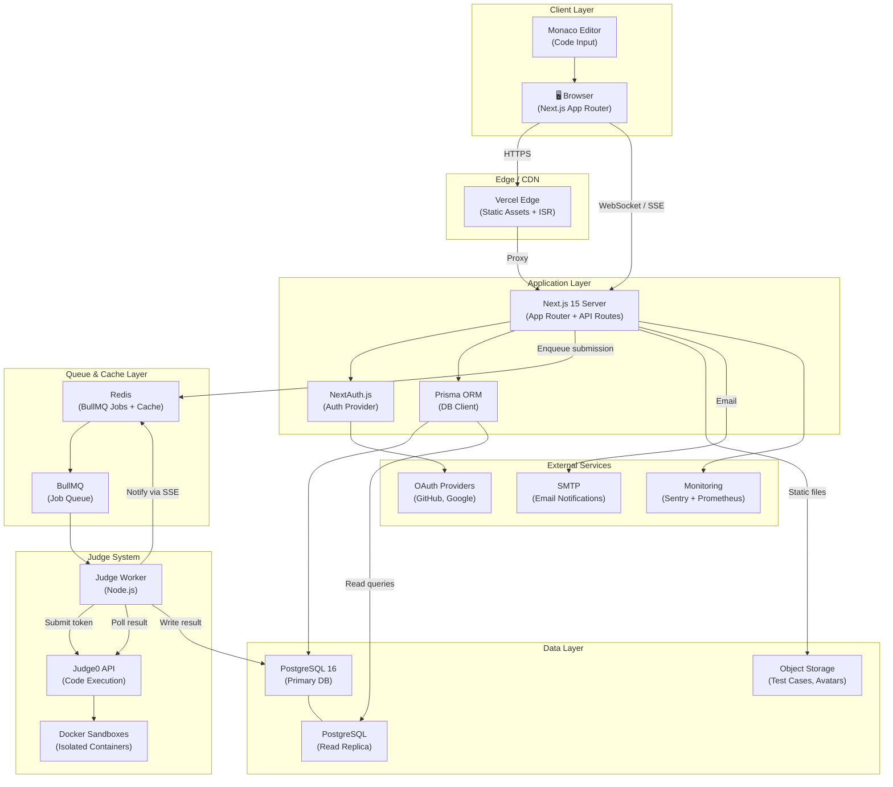
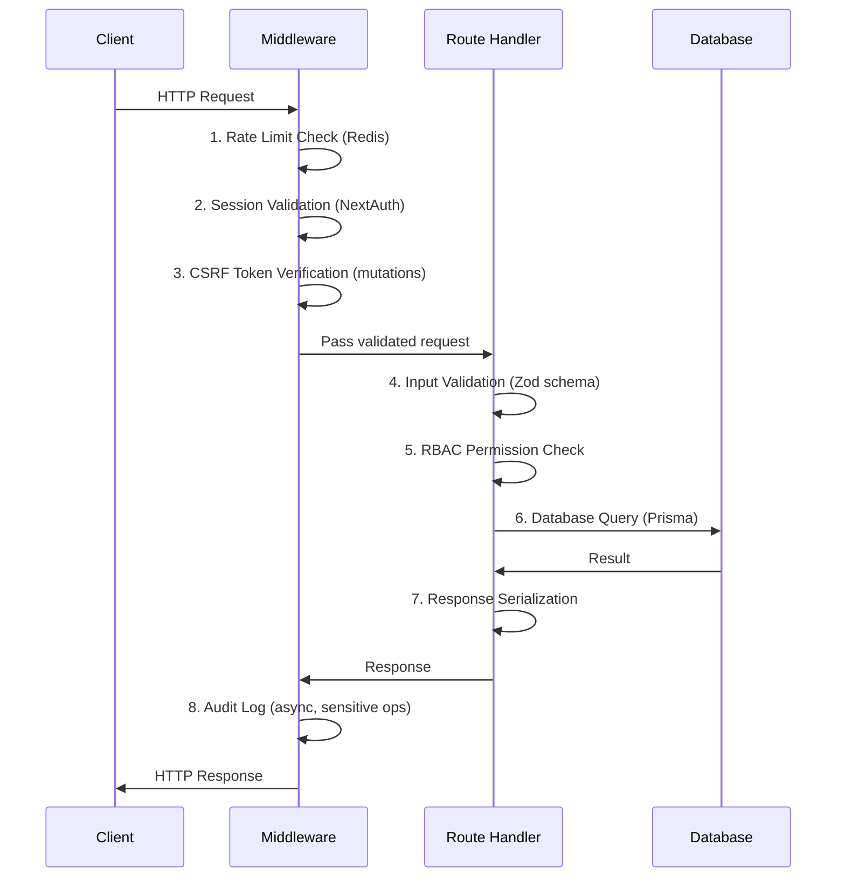
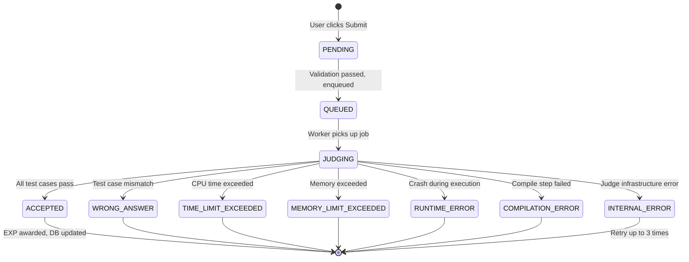
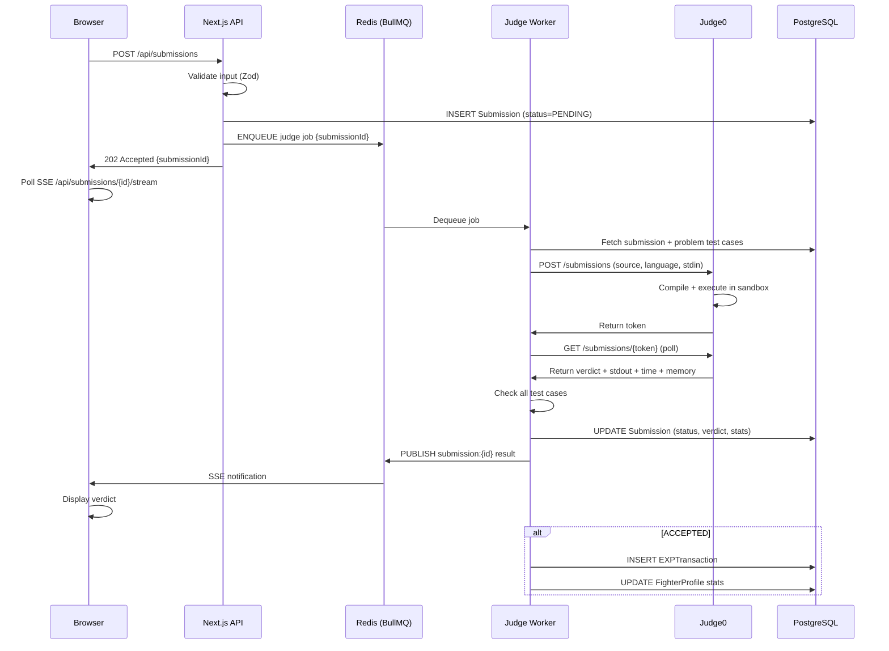
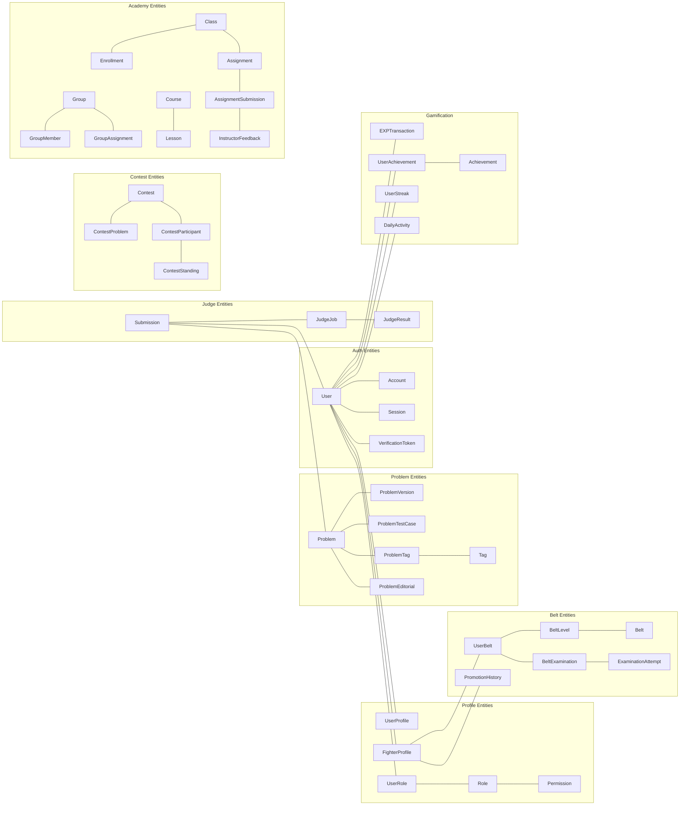
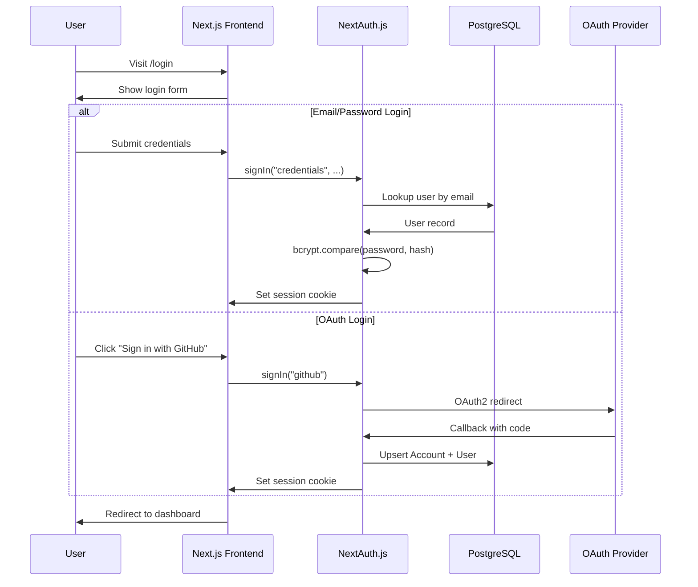
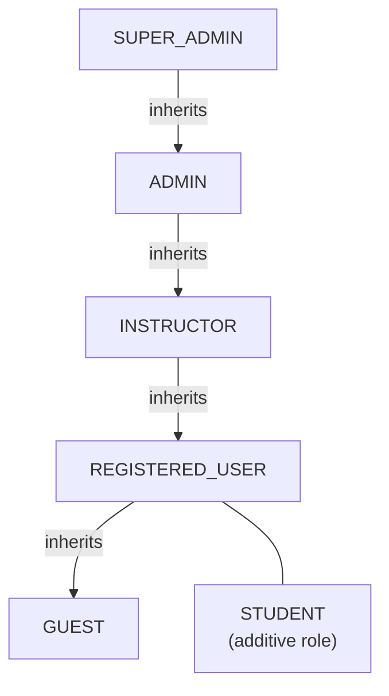
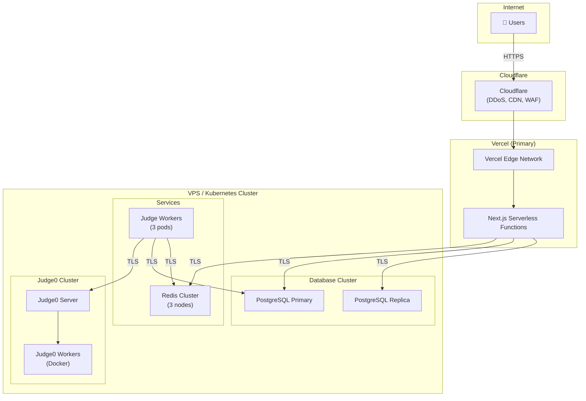
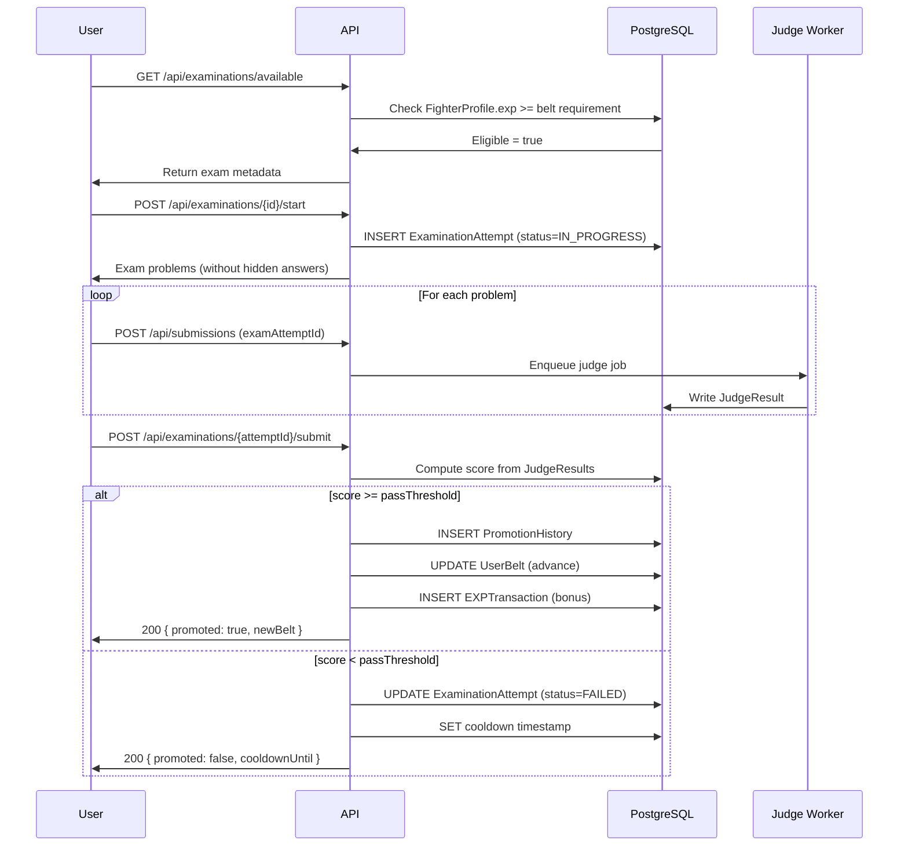

# CODE FIGHTER OJ — System Architecture

> **TRAIN LIKE A FIGHTER. CODE LIKE A CHAMPION.**

**Version:** 1.0.0  
**Status:** Draft  
**Last Updated:** 2026-11-08

---

## Table of Contents

1. [Architecture Overview](#1-architecture-overview)
2. [High-Level System Diagram](#2-high-level-system-diagram)
3. [Technology Stack](#3-technology-stack)
4. [Frontend Architecture](#4-frontend-architecture)
5. [Backend Architecture](#5-backend-architecture)
6. [Online Judge Pipeline](#6-online-judge-pipeline)
7. [Database Architecture](#7-database-architecture)
8. [Caching & Queue Layer](#8-caching--queue-layer)
9. [Authentication & Authorization](#9-authentication--authorization)
10. [Deployment Architecture](#10-deployment-architecture)
11. [Data Flow Diagrams](#11-data-flow-diagrams)
12. [Failure Modes & Resilience](#12-failure-modes--resilience)

---

## 1. Architecture Overview

CODE FIGHTER OJ is a **monolithic-first, service-aware** web application built on Next.js 15 with the App Router. The core application handles SSR, API routes, and static pages in a single deployable unit. External services (Judge0, Redis, PostgreSQL) are separated for independent scaling.

### Design Principles

| Principle | Implementation |
|-----------|---------------|
| **Server-first** | Next.js Server Components for data-heavy pages |
| **Type safety** | End-to-end TypeScript; Prisma-generated types |
| **Secure by default** | Input sanitization, RBAC, sandbox isolation |
| **Async judge** | Submissions never block the UI thread |
| **Cache aggressively** | Redis for leaderboards, session, rate-limiting |
| **Audit everything** | Immutable AuditLog for all sensitive operations |

---

## 2. High-Level System Diagram



---

## 3. Technology Stack

### 3.1 Core Stack

| Layer | Technology | Version | Purpose |
|-------|-----------|---------|---------|
| Framework | Next.js | 15.x | Full-stack React framework |
| Language | TypeScript | 5.x | Type-safe development |
| Styling | Tailwind CSS | 4.x | Utility-first CSS |
| UI Components | shadcn/ui | Latest | Accessible component library |
| Code Editor | Monaco Editor | Latest | In-browser IDE |
| ORM | Prisma | 5.x | Type-safe DB client |
| Database | PostgreSQL | 16 | Primary relational database |
| Cache/Queue | Redis | 7.x | Caching + BullMQ job queue |
| Auth | NextAuth.js v5 | 5.x | Authentication |
| Judge | Judge0 | CE 1.13+ | Code execution engine |
| Containerization | Docker | 24+ | Service isolation |

### 3.2 Development & Tooling

| Tool | Purpose |
|------|---------|
| pnpm | Fast, disk-efficient package manager |
| ESLint + Prettier | Code quality and formatting |
| Vitest | Unit and integration testing |
| Playwright | End-to-end testing |
| Prisma Migrate | Database schema migrations |
| Docker Compose | Local development environment |
| GitHub Actions | CI/CD pipelines |
| Sentry | Error tracking |

---

## 4. Frontend Architecture

### 4.1 Next.js App Router Structure

```
src/
├── app/                          # App Router
│   ├── (auth)/                   # Auth route group
│   │   ├── login/page.tsx
│   │   ├── register/page.tsx
│   │   └── verify/page.tsx
│   ├── (platform)/               # Main platform group
│   │   ├── layout.tsx            # Platform shell (navbar, sidebar)
│   │   ├── dashboard/page.tsx
│   │   ├── problems/
│   │   │   ├── page.tsx          # Problem list (SSR + pagination)
│   │   │   └── [slug]/
│   │   │       ├── page.tsx      # Problem statement
│   │   │       └── submit/page.tsx
│   │   ├── fighters/
│   │   │   ├── [username]/page.tsx   # Public profile
│   │   │   └── leaderboard/page.tsx
│   │   ├── belts/
│   │   │   ├── page.tsx          # Belt overview
│   │   │   └── examination/page.tsx
│   │   ├── contests/
│   │   │   ├── page.tsx
│   │   │   └── [id]/
│   │   │       ├── page.tsx
│   │   │       └── standings/page.tsx
│   │   ├── academy/
│   │   │   ├── courses/
│   │   │   ├── classes/
│   │   │   └── assignments/
│   │   └── groups/
│   ├── admin/                    # Admin area (server-only RBAC check)
│   └── api/                      # API route handlers
├── components/
│   ├── ui/                       # shadcn/ui base components
│   ├── judge/                    # Submission panel, verdict badge
│   ├── belt/                     # Belt badge, progress ring
│   ├── contest/                  # Scoreboard, timer
│   ├── editor/                   # Monaco wrapper, language selector
│   └── shared/                   # Navbar, sidebar, notifications
├── lib/
│   ├── auth.ts                   # NextAuth config
│   ├── prisma.ts                 # Prisma singleton
│   ├── redis.ts                  # Redis client
│   ├── judge.ts                  # Judge0 API wrapper
│   ├── rbac.ts                   # Permission checking utilities
│   └── utils.ts
├── hooks/                        # Custom React hooks
├── store/                        # Zustand client state
└── types/                        # Shared TypeScript types
```

### 4.2 Rendering Strategy

| Page | Strategy | Reason |
|------|----------|--------|
| Problem list | ISR (60s revalidate) | Frequently read, rarely changes |
| Problem detail | SSR | Auth-dependent (solved status, locked editorial) |
| Submission result | Client-side + SSE | Real-time judge updates |
| Leaderboard | ISR (30s) + Redis | High traffic, tolerate slight staleness |
| Contest scoreboard | SSE / WebSocket | Live updates required |
| User profile | SSR | Auth-dependent, SEO important |
| Admin pages | SSR | Sensitive, no caching |

### 4.3 State Management

- **Server State:** React Query (TanStack Query) for data fetching, caching, and invalidation.
- **Client State:** Zustand for editor preferences, notification drawer, contest timer.
- **Form State:** React Hook Form + Zod for all validated forms.

### 4.4 Monaco Editor Integration

```typescript
// components/editor/CodeEditor.tsx
import { Editor } from "@monaco-editor/react";

interface CodeEditorProps {
  language: SupportedLanguage;
  value: string;
  onChange: (value: string) => void;
  readOnly?: boolean;
  theme?: "vs-dark" | "light";
}
```

- Language switching triggers Monaco language mode change (no remount).
- Code is persisted to `localStorage` per problem per language (draft recovery).
- Editor is lazy-loaded to avoid blocking initial page load.

---

## 5. Backend Architecture

### 5.1 API Route Organization

All API routes live under `app/api/` and follow RESTful conventions:

```
/api/auth/[...nextauth]       # NextAuth.js handler
/api/users/                   # User management
/api/fighters/                # Fighter profiles, stats
/api/problems/                # Problem CRUD and listing
/api/submissions/             # Submission creation and history
/api/judge/                   # Judge result webhook
/api/contests/                # Contest management
/api/leaderboard/             # Leaderboard queries
/api/belts/                   # Belt info, requirements
/api/examinations/            # Examination management
/api/groups/                  # Group management
/api/courses/                 # Course CRUD
/api/classes/                 # Class management, enrollment
/api/assignments/             # Assignment CRUD, grading
/api/admin/                   # Admin-only operations
```

### 5.2 Middleware Pipeline



### 5.3 RBAC Implementation

Permissions are stored in the database (`Permission`, `Role`, `UserRole` tables). A utility function `checkPermission(session, resource, action)` validates access:

```typescript
// lib/rbac.ts
type Resource = "problem" | "submission" | "user" | "contest" | "examination";
type Action = "read" | "create" | "update" | "delete" | "admin";

async function requirePermission(
  session: Session,
  resource: Resource,
  action: Action
): Promise<void>;
// Throws 403 if permission not met
```

---

## 6. Online Judge Pipeline

### 6.1 Submission Lifecycle



### 6.2 Judge Worker Detail



### 6.3 Security Isolation Layers

| Layer | Mechanism |
|-------|----------|
| **Network** | Judge0 container has no external network access |
| **Filesystem** | Tmpfs only; no persistent writes |
| **Resources** | CPU time limit, memory limit, process limit enforced |
| **System calls** | Seccomp whitelist applied |
| **Language runtime** | Stripped-down images without dangerous libraries |
| **Input validation** | Maximum code size (64KB), maximum input size |
| **Hidden test cases** | Fetched by worker directly from DB; never sent to client |

---

## 7. Database Architecture

### 7.1 Entity Group Overview



### 7.2 Connection Pooling

- Prisma uses PgBouncer in transaction mode for connection pooling.
- Pool size: 20 connections per app instance.
- Read replicas receive SELECT queries for leaderboards and problem listings.

---

## 8. Caching & Queue Layer

### 8.1 Redis Usage Map

| Key Pattern | TTL | Content | Purpose |
|-------------|-----|---------|---------|
| `session:{id}` | 24h | Session object | NextAuth sessions |
| `leaderboard:global` | 60s | Sorted set | Global ranking |
| `leaderboard:weekly` | 60s | Sorted set | Weekly ranking |
| `rate:{ip}:{endpoint}` | 60s | Counter | Rate limiting |
| `rate:submit:{userId}` | 10s | Counter | Submission throttle |
| `problem:list:{page}:{filters}` | 120s | JSON | Problem list pages |
| `contest:standings:{id}` | 5s | JSON | Live scoreboard |
| `judge:result:{submissionId}` | 30s | JSON | SSE delivery |
| `belt:thresholds` | 3600s | JSON | Belt EXP config |

### 8.2 BullMQ Queue Configuration

```
Queue: judge-queue
  Priority levels: HIGH (contest), NORMAL (practice), LOW (upsolving)
  Concurrency: 10 workers per queue
  Retry: up to 3 attempts on INTERNAL_ERROR
  Backoff: exponential (1s, 2s, 4s)
  Timeout: 60s per job

Queue: notification-queue
  Concurrency: 5 workers
  For: email, in-app notifications

Queue: exp-queue
  Concurrency: 3 workers
  For: EXP calculation, achievement checking
```

---

## 9. Authentication & Authorization

### 9.1 Authentication Flow



### 9.2 Session Strategy
- **JWT sessions** stored in `httpOnly, Secure, SameSite=Strict` cookies.
- Refresh tokens rotated on each use.
- Session expiry: 24 hours; extends on activity.

### 9.3 Role-Based Access Control



Roles are **additive**: a user can have `REGISTERED_USER` + `INSTRUCTOR` simultaneously. `STUDENT` is granted per-class enrollment.

---

## 10. Deployment Architecture

### 10.1 Production Topology



### 10.2 Environment Tiers

| Environment | Purpose | Deployment |
|-------------|---------|-----------|
| `development` | Local dev | Docker Compose |
| `staging` | QA testing | Same infra, separate namespace |
| `production` | Live users | Full HA cluster |

---

## 11. Data Flow Diagrams

### 11.1 Belt Examination Flow



---

## 12. Failure Modes & Resilience

### 12.1 Judge System Failures

| Failure | Impact | Mitigation |
|---------|--------|-----------|
| Judge0 unavailable | Submissions queue | BullMQ retry with backoff; UI shows "queued" |
| Judge0 timeout | Single submission stuck | Per-job timeout; auto-mark as INTERNAL_ERROR after 60s |
| Worker crash | Jobs orphaned | BullMQ job lock expiry reclaims orphaned jobs |
| Wrong verdict | User trust damage | Rejudge capability for ADMIN; test case validation |

### 12.2 Database Failures

| Failure | Impact | Mitigation |
|---------|--------|-----------|
| Primary DB down | Writes fail | Automatic failover to replica (promoted to primary) |
| Slow query | API latency spike | Query timeouts (30s), connection pool limits |
| Migration failure | Deployment blocked | Blue-green deployment; rollback migration |

### 12.3 Redis Failures

| Failure | Impact | Mitigation |
|---------|--------|-----------|
| Redis down | Sessions, rate limiting, queues fail | Redis Sentinel HA; fallback to DB sessions (degraded) |
| Queue overflow | Submissions lost | Persistent BullMQ jobs with disk-backed queue |

### 12.4 Circuit Breakers

All external service calls (Judge0, SMTP, OAuth providers) are wrapped with circuit breakers:
- **Closed:** Normal operation.
- **Open:** After 5 failures in 60s; fail fast for 30s.
- **Half-open:** Test one request; close if successful.
